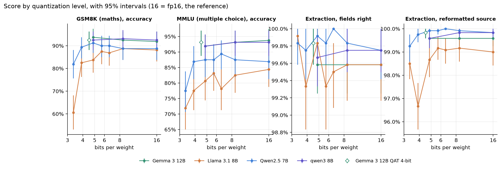
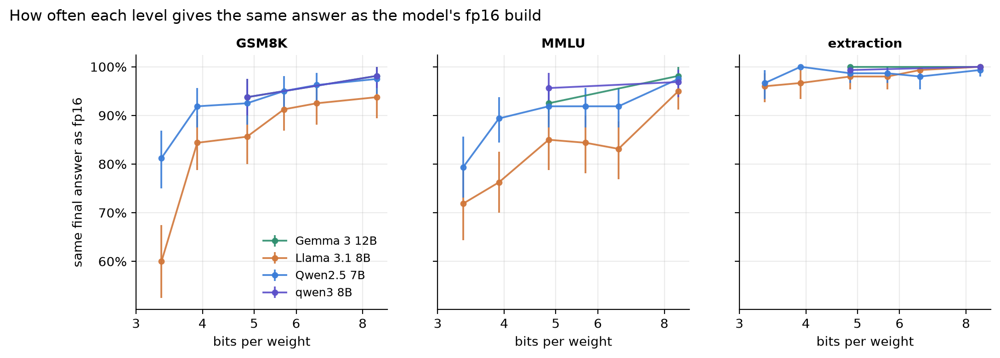

# quant-cliff

At what bit-width does a quantized LLM stop working, and does it break the same way on maths, knowledge
and extraction? Is the 4-bit build most people run (Ollama's default) free, and does a
quantization-aware 4-bit build do better than the ordinary one?

A measured study on local models (Ollama, llama.cpp GGUF): 21 builds of four models from fp16 down to
2-bit, on 160 GSM8K items, 160 MMLU items and 150 JSON extraction records, each build paired item by item
with its own fp16. The predictions and the analysis plan were committed before the full run
([HYPOTHESES.md](HYPOTHESES.md)), and so were the pass rules used to score them
([src/qcliff/score.py](src/qcliff/score.py)).

## Findings

Scored against the committed predictions: 8 held, 5 partly, 0 failed
([addendum](HYPOTHESES.md#addendum-2026-11-04-2130-est-scoring-after-the-full-run),
[scorecard](reports/scorecard.md), [all numbers](reports/results.md)). Drops are a level's score minus
fp16's on the same items; brackets are 95% item-bootstrap intervals.



**Down to 5 bits, nothing measurable is lost.** At q8_0 every drop, for all four models and three
tasks, is within 2 pp with an interval that includes zero. At q6_K and q5_K_M the two models with the full
ladder (Llama 3.1 8B, Qwen2.5 7B) stay within 3 pp, with one exception: Llama on MMLU at q6_K, −6.2 pp
[−11.9, −0.6], which recovers to −1.2 at q5_K_M and is not a trend.

**Ollama's default 4-bit costs one model a few points, and the others nothing.** At q4_K_M, Llama loses
4.4 pp on GSM8K [−9.4, +0.6] and 3.8 on MMLU [−9.4, +1.9]; qwen3 8B, Qwen2.5 7B and Gemma 3 12B are
within 2 pp on every task. In return q4_K_M is about a third of the size and generates 2.5–2.6× as fast
as fp16 on this laptop.

**The cliff is at 2 bits, and how far a model falls depends on the model.** At q2_K, Llama's GSM8K
accuracy drops from 88.1% to 60.6% (−27.5 pp [−35.6, −20.0]) and its MMLU from 84.4% to 71.9%. Qwen2.5,
at the same nominal bit-width, loses 6.9 pp on maths and 9.4 on MMLU. Llama already slips at q3_K_M
(−5.6 pp on GSM8K, −6.9 on MMLU); Qwen2.5 at q3_K_M is level with fp16. Llama's 2-bit loss is mostly
wrong reasoning, not running out of room: of the 49 items it gets wrong at q2_K and right at fp16, 10
are replies cut off at the cap, and among replies that finished it is right on 66.9%. The cut-off ones
loop ("The Equator is not used to determine absolute location." until the cap).

**Extraction barely notices.** Filling an 8-field JSON record from a restaurant description, every
build of every model gets at least 99.3% of fields right on the base source, down to 2 bits. Values
written in an unfamiliar format ("20-25 GBP" for "£20-25") cost slightly more at low bit-widths, at
most −2.3 pp (Llama, q3_K_M). The one thing that changes is format: at q2_K, Llama stops wrapping its
JSON in a code fence, which it does on every record at every other level (0% → 100% bare JSON).



**Answers move before accuracy does.** Sending the same prompt twice at q4_K_M changed 2 of 1,280
answers, so the sampling itself is quiet. Against that, q8_0, with no accuracy cost, already gives a
different final answer from fp16 on 2–6% of maths and multiple-choice items, and q4_K_M on 4–15%.
At q8_0 the changes cancel out: of 40 changed answers across the four models, 14 are one wrong
answer swapped for another, 13 right → wrong and 13 wrong → right. Same accuracy is not the same model: a regression suite that compares outputs will see
changes at 8 bits that a benchmark score does not.

**The quantization-aware 4-bit build is slightly closer to fp16, within noise.** Gemma 3 12B's QAT
build gives the same answer as fp16 on 94.1% of items against 93.1% for its ordinary q4_K_M, and its
accuracy is within 1 pp of fp16 on every task. The ordinary q4_K_M is also within 2 pp, so on these
tasks there was little for QAT to recover.

**Below 4 bits, little speed is left to buy.** q2_K generates about 1.2–1.3× as fast as q4_K_M and saves
about 1.7 GB, for 9–23 pp less on maths.

**What to take from it.** For 7–12B instruct models on tasks like these, 5 bits and up is free and
q4_K_M is close to free. Below 4 bits, measure the specific model: two models of the same size at the
same bit-width lost 7 and 27 points. And if what matters is that outputs stay the same, not just the
score, expect changes even at 8 bits.

## Design

- **Models and levels** (Ollama library tags, llama.cpp GGUF): Llama 3.1 8B Instruct and Qwen2.5 7B
  Instruct at fp16, q8_0, q6_K, q5_K_M, q4_K_M, q3_K_M and q2_K; qwen3 8B (thinking off) at fp16, q8_0
  and q4_K_M; Gemma 3 12B at fp16, q8_0, q4_K_M and its quantization-aware-trained 4-bit build (QAT).
  21 builds; tags in [src/qcliff/config.py](src/qcliff/config.py), digests in `results/models.json`.
  Ollama's untagged `llama3.1:8b`, `qwen3:8b` and `gemma3:12b` are the q4_K_M builds.
- **Items:** 160 GSM8K and 160 MMLU (high-school biology, geography, macroeconomics and psychology), the
  seeded draws of [prompt-brittleness](https://github.com/Srikarmk/prompt-brittleness),
  [format-tax](https://github.com/Srikarmk/format-tax) and
  [groupthink](https://github.com/Srikarmk/groupthink), answered with format-tax's free-text,
  reasoning-first prompt. And format-tax's 150 E2E NLG restaurant records, converted to a fixed 8-field
  JSON object (prompt only, no constrained decoding), from the base export and from a version with
  values reformatted. Ten pilot items per task, used to check prompts, parser and analysis, are
  excluded from every reported number.
- **Settings:** temperature 0, seed 7, `num_ctx` 4,096; output caps 1,024 (GSM8K), 768 (MMLU) and 300
  (extraction) tokens.
- **Reference:** each model's own fp16 build. **Noise floor:** GSM8K and MMLU sent a second time at
  q4_K_M (A/A).
- **Scoring:** GSM8K and MMLU right or wrong, with an unparsed reply counted as wrong; extraction as the
  share of the 8 fields right per record. "Same answer" counts an unparsed reply as a changed one.
- **Statistics:** paired differences from fp16 with a 95% percentile bootstrap over items (2,000
  draws). "First clear drop": walking down from fp16, the first level whose drop is at least 5 pp with
  an interval excluding zero.

## Reproduce

Requires [uv](https://docs.astral.sh/uv/) and [Ollama](https://ollama.com) with the 21 tags pulled
(about 181 GB; the fp16 builds need 15–25 GB of memory each).

```sh
uv sync
uv run qcliff fetch          # pinned Hugging Face files, sha256-checked
uv run qcliff items          # data/items.jsonl: 470 main items and 30 pilot items, seeded
uv run qcliff run            # every build, every task (14,300 calls)
uv run qcliff show gsm8k-0062 --families llama3.1-8b --full   # one item's replies, level by level
uv run qcliff report         # reports/results.md and reports/figures/
uv run qcliff score          # reports/scorecard.md: each prediction against its pass rule
uv run pytest
```

Every model call is cached in `cache/llm.sqlite`, keyed by model, messages, options and a repeat tag
(the A/A repeat is a real second call). With the cache present, `qcliff run --cache-only` rebuilds
`results/answers/` without a server, and `report` and `score` re-read every stored reply.

Runtime: 14,300 calls on the main items plus 1,000 in the pilot; the main run took about 25 hours on an
M5 Pro laptop with 48 GB (2026-11-03 19:50 to 2026-11-04 21:00 EST). Tokens per second in the report are
wall-clock on that machine, a rough guide only.

## Data and models

| Item | Source | Version | Licence |
|---|---|---|---|
| GSM8K test | Hugging Face `openai/gsm8k` | commit `740312add88f781978c0658806c59bc2815b9866` | MIT |
| MMLU test (4 high-school subjects) | Hugging Face `cais/mmlu` | commit `c30699e8356da336a370243923dbaf21066bb9fe` | MIT |
| E2E NLG (cleaned) test | Hugging Face `tuetschek/e2e_nlg_cleaned` | commit `6f77a74f6ce3095770924452f3f1b9631f837535` | CC BY-SA 4.0 |
| Models | Ollama library tags (see config) | digests in `results/models.json` | Llama 3.1 Community Licence, Apache 2.0 (Qwen2.5, Qwen3), Gemma Terms of Use |

## Layout

```
src/qcliff/  config (builds, caps, sources), data (fetch, item sampling), prompts, parse (answers,
             JSON fields), llm (Ollama + disk cache), runner, stats, analysis, report, score, cli
tests/       parsers and prompts
data/        items.jsonl and sources.json
results/     answers/<model>_<level>.jsonl (one row per call) and models.json (digests, sizes)
reports/     results.md, scorecard.md, their pilot versions, and figures/
cache/       llm.sqlite: every model call
```

## Limits

- Four 7–12B instruct models, one seed, greedy decoding, Ollama's library builds. Other quantizers
  (AWQ, GPTQ, imatrix GGUFs, MLX) and larger models may break at different points.
- 160 items per task: an interval on a maths or MMLU drop spans ±2 to ±6 pp, so a 2–3 pp loss can't be told apart
  from none. "Free" here means "no loss this study could detect".
- qwen3 and Gemma 3 are published only down to 4 bits, so the cliff is measured on two models, and
  they disagree by 20 pp on where it is.
- The tasks are short: no long context, tool use or multi-turn. Extraction is near ceiling for every
  build, so it can show only that low bits don't hurt it, not how much they would hurt a harder schema.
- The "same answer" rates and the reading of 2-bit failure modes are descriptive; only the predictions
  in HYPOTHESES.md were fixed in advance.

## License

MIT for the code. The datasets and models keep their own licences (table above).
