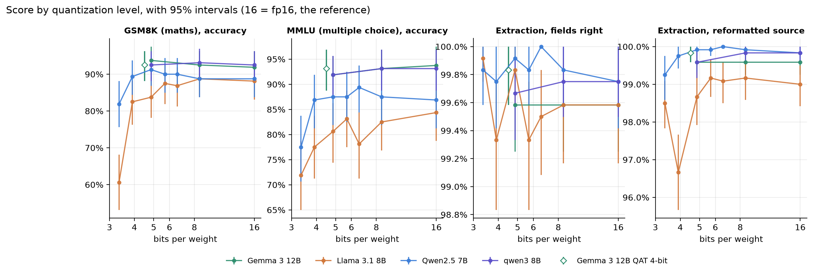
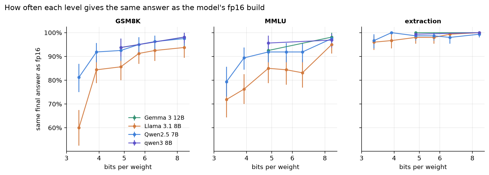

# Results (main items)

Generated by `qcliff report` from `results/answers/`. Intervals are 95% item bootstraps (2,000 draws). Drops are paired by item against the same model's fp16 build. Extraction is scored as the share of the 8 fields right per record.

## Score by level

### Llama 3.1 8B (n = 160 per task, 150 records)

Score, and in brackets the drop from fp16 in points.

| level | bits | GSM8K | MMLU | extraction | extraction (reformatted) |
|---|---|---|---|---|---|
| fp16 | 16.0 | 88.1% (+0.0) | 84.4% (+0.0) | 99.6% (+0.0) | 99.0% (+0.0) |
| q8_0 | 8.5 | 88.8% (+0.6) | 82.5% (-1.9) | 99.6% (+0.0) | 99.2% (+0.2) |
| q6_K | 6.56 | 86.9% (-1.2) | 78.1% (-6.2) | 99.5% (-0.1) | 99.1% (+0.1) |
| q5_K_M | 5.69 | 87.5% (-0.6) | 83.1% (-1.2) | 99.3% (-0.2) | 99.2% (+0.2) |
| q4_K_M | 4.85 | 83.8% (-4.4) | 80.6% (-3.8) | 99.8% (+0.2) | 98.7% (-0.3) |
| q3_K_M | 3.91 | 82.5% (-5.6) | 77.5% (-6.9) | 99.3% (-0.2) | 96.7% (-2.3) |
| q2_K | 3.35 | 60.6% (-27.5) | 71.9% (-12.5) | 99.9% (+0.3) | 98.5% (-0.5) |

### Qwen2.5 7B (n = 160 per task, 150 records)

Score, and in brackets the drop from fp16 in points.

| level | bits | GSM8K | MMLU | extraction | extraction (reformatted) |
|---|---|---|---|---|---|
| fp16 | 16.0 | 88.8% (+0.0) | 86.9% (+0.0) | 99.8% (+0.0) | 99.8% (+0.0) |
| q8_0 | 8.5 | 88.8% (+0.0) | 87.5% (+0.6) | 99.8% (+0.1) | 99.9% (+0.1) |
| q6_K | 6.56 | 90.0% (+1.2) | 89.4% (+2.5) | 100.0% (+0.2) | 100.0% (+0.2) |
| q5_K_M | 5.69 | 90.0% (+1.2) | 87.5% (+0.6) | 99.8% (+0.1) | 99.9% (+0.1) |
| q4_K_M | 4.85 | 91.2% (+2.5) | 87.5% (+0.6) | 99.9% (+0.2) | 99.9% (+0.1) |
| q3_K_M | 3.91 | 89.4% (+0.6) | 86.9% (+0.0) | 99.8% (+0.0) | 99.8% (-0.1) |
| q2_K | 3.35 | 81.9% (-6.9) | 77.5% (-9.4) | 99.8% (+0.1) | 99.2% (-0.6) |

### qwen3 8B (n = 160 per task, 150 records)

Score, and in brackets the drop from fp16 in points.

| level | bits | GSM8K | MMLU | extraction | extraction (reformatted) |
|---|---|---|---|---|---|
| fp16 | 16.0 | 92.5% (+0.0) | 93.1% (+0.0) | 99.8% (+0.0) | 99.8% (+0.0) |
| q8_0 | 8.5 | 93.1% (+0.6) | 93.1% (+0.0) | 99.8% (+0.0) | 99.8% (+0.0) |
| q4_K_M | 4.85 | 92.5% (+0.0) | 91.9% (-1.2) | 99.7% (-0.1) | 99.6% (-0.2) |

### Gemma 3 12B (n = 160 per task, 150 records)

Score, and in brackets the drop from fp16 in points.

| level | bits | GSM8K | MMLU | extraction | extraction (reformatted) |
|---|---|---|---|---|---|
| fp16 | 16.0 | 91.9% (+0.0) | 93.8% (+0.0) | 99.6% (+0.0) | 99.6% (+0.0) |
| q8_0 | 8.5 | 92.5% (+0.6) | 93.1% (-0.6) | 99.6% (+0.0) | 99.6% (+0.0) |
| q4_K_M | 4.85 | 93.8% (+1.9) | 91.9% (-1.9) | 99.6% (+0.0) | 99.6% (+0.0) |
| qat | 4.5 | 92.5% (+0.6) | 93.1% (-0.6) | 99.8% (+0.2) | 99.8% (+0.2) |

## Drops from fp16 (pp, paired by item)

| model | task | level | drop | 95% CI | n |
|---|---|---|---|---|---|
| Llama 3.1 8B | GSM8K | q8_0 | +0.6 | [-1.9, +3.1] | 160 |
| Llama 3.1 8B | GSM8K | q6_K | -1.2 | [-5.0, +1.9] | 160 |
| Llama 3.1 8B | GSM8K | q5_K_M | -0.6 | [-4.4, +3.1] | 160 |
| Llama 3.1 8B | GSM8K | q4_K_M | -4.4 | [-9.4, +0.6] | 160 |
| Llama 3.1 8B | GSM8K | q3_K_M | -5.6 | [-10.6, -0.6] | 160 |
| Llama 3.1 8B | GSM8K | q2_K | -27.5 | [-35.6, -20.0] | 160 |
| Llama 3.1 8B | MMLU | q8_0 | -1.9 | [-5.0, +0.6] | 160 |
| Llama 3.1 8B | MMLU | q6_K | -6.2 | [-11.9, -0.6] | 160 |
| Llama 3.1 8B | MMLU | q5_K_M | -1.2 | [-6.9, +4.4] | 160 |
| Llama 3.1 8B | MMLU | q4_K_M | -3.8 | [-9.4, +1.9] | 160 |
| Llama 3.1 8B | MMLU | q3_K_M | -6.9 | [-13.8, +0.0] | 160 |
| Llama 3.1 8B | MMLU | q2_K | -12.5 | [-19.4, -5.0] | 160 |
| Llama 3.1 8B | extraction | q8_0 | +0.0 | [+0.0, +0.0] | 150 |
| Llama 3.1 8B | extraction | q6_K | -0.1 | [-0.2, +0.0] | 150 |
| Llama 3.1 8B | extraction | q5_K_M | -0.2 | [-0.6, +0.0] | 150 |
| Llama 3.1 8B | extraction | q4_K_M | +0.2 | [+0.0, +0.6] | 150 |
| Llama 3.1 8B | extraction | q3_K_M | -0.2 | [-0.7, +0.1] | 150 |
| Llama 3.1 8B | extraction | q2_K | +0.3 | [+0.0, +0.8] | 150 |
| Llama 3.1 8B | extraction (reformatted) | q8_0 | +0.2 | [-0.2, +0.5] | 150 |
| Llama 3.1 8B | extraction (reformatted) | q6_K | +0.1 | [+0.0, +0.2] | 150 |
| Llama 3.1 8B | extraction (reformatted) | q5_K_M | +0.2 | [-0.2, +0.6] | 150 |
| Llama 3.1 8B | extraction (reformatted) | q4_K_M | -0.3 | [-1.1, +0.2] | 150 |
| Llama 3.1 8B | extraction (reformatted) | q3_K_M | -2.3 | [-3.2, -1.4] | 150 |
| Llama 3.1 8B | extraction (reformatted) | q2_K | -0.5 | [-1.3, +0.2] | 150 |
| Qwen2.5 7B | GSM8K | q8_0 | +0.0 | [-1.9, +1.9] | 160 |
| Qwen2.5 7B | GSM8K | q6_K | +1.2 | [+0.0, +3.1] | 160 |
| Qwen2.5 7B | GSM8K | q5_K_M | +1.2 | [-1.9, +4.4] | 160 |
| Qwen2.5 7B | GSM8K | q4_K_M | +2.5 | [-0.6, +6.2] | 160 |
| Qwen2.5 7B | GSM8K | q3_K_M | +0.6 | [-3.1, +3.8] | 160 |
| Qwen2.5 7B | GSM8K | q2_K | -6.9 | [-12.5, -1.9] | 160 |
| Qwen2.5 7B | MMLU | q8_0 | +0.6 | [-1.9, +3.1] | 160 |
| Qwen2.5 7B | MMLU | q6_K | +2.5 | [-1.9, +6.9] | 160 |
| Qwen2.5 7B | MMLU | q5_K_M | +0.6 | [-3.1, +4.4] | 160 |
| Qwen2.5 7B | MMLU | q4_K_M | +0.6 | [-4.4, +5.0] | 160 |
| Qwen2.5 7B | MMLU | q3_K_M | +0.0 | [-5.0, +4.4] | 160 |
| Qwen2.5 7B | MMLU | q2_K | -9.4 | [-16.2, -3.1] | 160 |
| Qwen2.5 7B | extraction | q8_0 | +0.1 | [+0.0, +0.2] | 150 |
| Qwen2.5 7B | extraction | q6_K | +0.2 | [+0.0, +0.6] | 150 |
| Qwen2.5 7B | extraction | q5_K_M | +0.1 | [+0.0, +0.2] | 150 |
| Qwen2.5 7B | extraction | q4_K_M | +0.2 | [+0.0, +0.4] | 150 |
| Qwen2.5 7B | extraction | q3_K_M | +0.0 | [+0.0, +0.0] | 150 |
| Qwen2.5 7B | extraction | q2_K | +0.1 | [-0.3, +0.4] | 150 |
| Qwen2.5 7B | extraction (reformatted) | q8_0 | +0.1 | [+0.0, +0.2] | 150 |
| Qwen2.5 7B | extraction (reformatted) | q6_K | +0.2 | [+0.0, +0.4] | 150 |
| Qwen2.5 7B | extraction (reformatted) | q5_K_M | +0.1 | [+0.0, +0.2] | 150 |
| Qwen2.5 7B | extraction (reformatted) | q4_K_M | +0.1 | [+0.0, +0.2] | 150 |
| Qwen2.5 7B | extraction (reformatted) | q3_K_M | -0.1 | [-0.2, +0.0] | 150 |
| Qwen2.5 7B | extraction (reformatted) | q2_K | -0.6 | [-1.2, +0.0] | 150 |
| qwen3 8B | GSM8K | q8_0 | +0.6 | [-1.2, +2.5] | 160 |
| qwen3 8B | GSM8K | q4_K_M | +0.0 | [-3.1, +3.1] | 160 |
| qwen3 8B | MMLU | q8_0 | +0.0 | [-2.5, +2.5] | 160 |
| qwen3 8B | MMLU | q4_K_M | -1.2 | [-4.4, +1.2] | 160 |
| qwen3 8B | extraction | q8_0 | +0.0 | [+0.0, +0.0] | 150 |
| qwen3 8B | extraction | q4_K_M | -0.1 | [-0.2, +0.0] | 150 |
| qwen3 8B | extraction (reformatted) | q8_0 | +0.0 | [+0.0, +0.0] | 150 |
| qwen3 8B | extraction (reformatted) | q4_K_M | -0.2 | [-0.6, +0.0] | 150 |
| Gemma 3 12B | GSM8K | q8_0 | +0.6 | [+0.0, +1.9] | 160 |
| Gemma 3 12B | GSM8K | q4_K_M | +1.9 | [-1.2, +5.0] | 160 |
| Gemma 3 12B | GSM8K | qat | +0.6 | [-2.5, +3.8] | 160 |
| Gemma 3 12B | MMLU | q8_0 | -0.6 | [-3.1, +1.2] | 160 |
| Gemma 3 12B | MMLU | q4_K_M | -1.9 | [-5.6, +1.9] | 160 |
| Gemma 3 12B | MMLU | qat | -0.6 | [-4.4, +2.5] | 160 |
| Gemma 3 12B | extraction | q8_0 | +0.0 | [+0.0, +0.0] | 150 |
| Gemma 3 12B | extraction | q4_K_M | +0.0 | [+0.0, +0.0] | 150 |
| Gemma 3 12B | extraction | qat | +0.2 | [+0.0, +0.6] | 150 |
| Gemma 3 12B | extraction (reformatted) | q8_0 | +0.0 | [+0.0, +0.0] | 150 |
| Gemma 3 12B | extraction (reformatted) | q4_K_M | +0.0 | [+0.0, +0.0] | 150 |
| Gemma 3 12B | extraction (reformatted) | qat | +0.2 | [+0.0, +0.6] | 150 |

## First clear drop

Walking down from fp16, the first level whose drop is at least 5 points with an interval that excludes zero (QAT left out).

| family | task | variant | first clear drop | drop there | lowest level tested | drop at lowest |
|---|---|---|---|---|---|---|
| gemma3-12b | drift | base | none | – | q4_K_M | +0.0 |
| gemma3-12b | drift | reformatted | none | – | q4_K_M | +0.0 |
| gemma3-12b | gsm8k | base | none | – | q4_K_M | +1.9 |
| gemma3-12b | mmlu | base | none | – | q4_K_M | -1.9 |
| llama3.1-8b | drift | base | none | – | q2_K | +0.3 |
| llama3.1-8b | drift | reformatted | none | – | q2_K | -0.5 |
| llama3.1-8b | gsm8k | base | q3_K_M | -5.6 | q2_K | -27.5 |
| llama3.1-8b | mmlu | base | q6_K | -6.2 | q2_K | -12.5 |
| qwen2.5-7b | drift | base | none | – | q2_K | +0.1 |
| qwen2.5-7b | drift | reformatted | none | – | q2_K | -0.6 |
| qwen2.5-7b | gsm8k | base | q2_K | -6.9 | q2_K | -6.9 |
| qwen2.5-7b | mmlu | base | q2_K | -9.4 | q2_K | -9.4 |
| qwen3-8b | drift | base | none | – | q4_K_M | -0.1 |
| qwen3-8b | drift | reformatted | none | – | q4_K_M | -0.2 |
| qwen3-8b | gsm8k | base | none | – | q4_K_M | +0.0 |
| qwen3-8b | mmlu | base | none | – | q4_K_M | -1.2 |

## Same answer as fp16

| model | task | level | same answer | 95% CI | n |
|---|---|---|---|---|---|
| Llama 3.1 8B | GSM8K | fp16 | 100.0% | [100.0, 100.0] | 160 |
| Llama 3.1 8B | GSM8K | q8_0 | 93.8% | [89.4, 96.9] | 160 |
| Llama 3.1 8B | GSM8K | q6_K | 92.5% | [88.1, 96.2] | 160 |
| Llama 3.1 8B | GSM8K | q5_K_M | 91.2% | [86.9, 95.6] | 160 |
| Llama 3.1 8B | GSM8K | q4_K_M | 85.6% | [80.0, 90.6] | 160 |
| Llama 3.1 8B | GSM8K | q3_K_M | 84.4% | [78.8, 90.0] | 160 |
| Llama 3.1 8B | GSM8K | q2_K | 60.0% | [52.5, 67.5] | 160 |
| Llama 3.1 8B | MMLU | fp16 | 98.8% | [96.9, 100.0] | 160 |
| Llama 3.1 8B | MMLU | q8_0 | 95.0% | [91.2, 98.1] | 160 |
| Llama 3.1 8B | MMLU | q6_K | 83.1% | [76.9, 88.8] | 160 |
| Llama 3.1 8B | MMLU | q5_K_M | 84.4% | [78.1, 90.0] | 160 |
| Llama 3.1 8B | MMLU | q4_K_M | 85.0% | [78.8, 90.6] | 160 |
| Llama 3.1 8B | MMLU | q3_K_M | 76.2% | [70.0, 82.5] | 160 |
| Llama 3.1 8B | MMLU | q2_K | 71.9% | [64.4, 78.8] | 160 |
| Llama 3.1 8B | extraction | fp16 | 100.0% | [100.0, 100.0] | 150 |
| Llama 3.1 8B | extraction | q8_0 | 100.0% | [100.0, 100.0] | 150 |
| Llama 3.1 8B | extraction | q6_K | 99.3% | [98.0, 100.0] | 150 |
| Llama 3.1 8B | extraction | q5_K_M | 98.0% | [95.3, 100.0] | 150 |
| Llama 3.1 8B | extraction | q4_K_M | 98.0% | [95.3, 100.0] | 150 |
| Llama 3.1 8B | extraction | q3_K_M | 96.7% | [93.3, 99.3] | 150 |
| Llama 3.1 8B | extraction | q2_K | 96.0% | [92.7, 98.7] | 150 |
| Qwen2.5 7B | GSM8K | fp16 | 100.0% | [100.0, 100.0] | 160 |
| Qwen2.5 7B | GSM8K | q8_0 | 97.5% | [94.4, 99.4] | 160 |
| Qwen2.5 7B | GSM8K | q6_K | 96.2% | [93.1, 98.8] | 160 |
| Qwen2.5 7B | GSM8K | q5_K_M | 95.0% | [91.2, 98.1] | 160 |
| Qwen2.5 7B | GSM8K | q4_K_M | 92.5% | [88.1, 96.2] | 160 |
| Qwen2.5 7B | GSM8K | q3_K_M | 91.9% | [87.5, 95.6] | 160 |
| Qwen2.5 7B | GSM8K | q2_K | 81.2% | [75.0, 86.9] | 160 |
| Qwen2.5 7B | MMLU | fp16 | 99.4% | [98.1, 100.0] | 160 |
| Qwen2.5 7B | MMLU | q8_0 | 97.5% | [95.0, 99.4] | 160 |
| Qwen2.5 7B | MMLU | q6_K | 91.9% | [87.5, 95.6] | 160 |
| Qwen2.5 7B | MMLU | q5_K_M | 91.9% | [87.5, 95.6] | 160 |
| Qwen2.5 7B | MMLU | q4_K_M | 91.9% | [87.5, 95.6] | 160 |
| Qwen2.5 7B | MMLU | q3_K_M | 89.4% | [84.4, 93.8] | 160 |
| Qwen2.5 7B | MMLU | q2_K | 79.4% | [73.1, 85.6] | 160 |
| Qwen2.5 7B | extraction | fp16 | 100.0% | [100.0, 100.0] | 150 |
| Qwen2.5 7B | extraction | q8_0 | 99.3% | [98.0, 100.0] | 150 |
| Qwen2.5 7B | extraction | q6_K | 98.0% | [95.3, 100.0] | 150 |
| Qwen2.5 7B | extraction | q5_K_M | 98.7% | [96.7, 100.0] | 150 |
| Qwen2.5 7B | extraction | q4_K_M | 98.7% | [96.7, 100.0] | 150 |
| Qwen2.5 7B | extraction | q3_K_M | 100.0% | [100.0, 100.0] | 150 |
| Qwen2.5 7B | extraction | q2_K | 96.7% | [93.3, 99.3] | 150 |
| qwen3 8B | GSM8K | fp16 | 100.0% | [100.0, 100.0] | 160 |
| qwen3 8B | GSM8K | q8_0 | 98.1% | [95.6, 100.0] | 160 |
| qwen3 8B | GSM8K | q4_K_M | 93.8% | [90.0, 97.5] | 160 |
| qwen3 8B | MMLU | fp16 | 100.0% | [100.0, 100.0] | 160 |
| qwen3 8B | MMLU | q8_0 | 96.9% | [93.8, 99.4] | 160 |
| qwen3 8B | MMLU | q4_K_M | 95.6% | [91.9, 98.8] | 160 |
| qwen3 8B | extraction | fp16 | 100.0% | [100.0, 100.0] | 150 |
| qwen3 8B | extraction | q8_0 | 100.0% | [100.0, 100.0] | 150 |
| qwen3 8B | extraction | q4_K_M | 99.3% | [98.0, 100.0] | 150 |
| Gemma 3 12B | GSM8K | fp16 | 100.0% | [100.0, 100.0] | 160 |
| Gemma 3 12B | GSM8K | q8_0 | 98.1% | [95.6, 100.0] | 160 |
| Gemma 3 12B | GSM8K | q4_K_M | 93.8% | [90.0, 97.5] | 160 |
| Gemma 3 12B | GSM8K | qat | 93.8% | [90.0, 97.5] | 160 |
| Gemma 3 12B | MMLU | fp16 | 100.0% | [100.0, 100.0] | 160 |
| Gemma 3 12B | MMLU | q8_0 | 98.1% | [95.6, 100.0] | 160 |
| Gemma 3 12B | MMLU | q4_K_M | 92.5% | [88.1, 96.2] | 160 |
| Gemma 3 12B | MMLU | qat | 94.4% | [90.6, 97.5] | 160 |
| Gemma 3 12B | extraction | fp16 | 100.0% | [100.0, 100.0] | 150 |
| Gemma 3 12B | extraction | q8_0 | 100.0% | [100.0, 100.0] | 150 |
| Gemma 3 12B | extraction | q4_K_M | 100.0% | [100.0, 100.0] | 150 |
| Gemma 3 12B | extraction | qat | 98.0% | [95.3, 100.0] | 150 |

## Noise floor (A/A: the same prompt sent twice)

| family | level | task | n | changed |
|---|---|---|---|---|
| llama3.1-8b | q4_K_M | gsm8k | 160 | 0 |
| llama3.1-8b | q4_K_M | mmlu | 160 | 0 |
| qwen2.5-7b | q4_K_M | gsm8k | 160 | 0 |
| qwen2.5-7b | q4_K_M | mmlu | 160 | 0 |
| qwen3-8b | q4_K_M | gsm8k | 160 | 0 |
| qwen3-8b | q4_K_M | mmlu | 160 | 2 |
| gemma3-12b | q4_K_M | gsm8k | 160 | 0 |
| gemma3-12b | q4_K_M | mmlu | 160 | 0 |

## Validity

| family | level | bits | unparsed (maths+MC) | truncated | extraction JSON parsed | extraction strict JSON | mean output tokens (GSM8K) |
|---|---|---|---|---|---|---|---|
| gemma3-12b | fp16 | 16.0 | 0 | 1 | 300/300 | 0/300 | 221.0 |
| gemma3-12b | q8_0 | 8.5 | 0 | 1 | 300/300 | 0/300 | 222.0 |
| gemma3-12b | q4_K_M | 4.85 | 0 | 2 | 300/300 | 0/300 | 243.0 |
| gemma3-12b | qat | 4.5 | 0 | 1 | 300/300 | 0/300 | 215.0 |
| llama3.1-8b | fp16 | 16.0 | 2 | 3 | 300/300 | 0/300 | 223.0 |
| llama3.1-8b | q8_0 | 8.5 | 0 | 2 | 300/300 | 0/300 | 225.0 |
| llama3.1-8b | q6_K | 6.56 | 0 | 2 | 300/300 | 0/300 | 226.0 |
| llama3.1-8b | q5_K_M | 5.69 | 1 | 2 | 300/300 | 0/300 | 226.0 |
| llama3.1-8b | q4_K_M | 4.85 | 0 | 0 | 300/300 | 0/300 | 219.0 |
| llama3.1-8b | q3_K_M | 3.91 | 2 | 4 | 300/300 | 0/300 | 222.0 |
| llama3.1-8b | q2_K | 3.35 | 3 | 20 | 300/300 | 300/300 | 306.0 |
| qwen2.5-7b | fp16 | 16.0 | 1 | 0 | 300/300 | 300/300 | 275.0 |
| qwen2.5-7b | q8_0 | 8.5 | 1 | 0 | 300/300 | 300/300 | 275.0 |
| qwen2.5-7b | q6_K | 6.56 | 0 | 0 | 300/300 | 300/300 | 270.0 |
| qwen2.5-7b | q5_K_M | 5.69 | 1 | 2 | 300/300 | 300/300 | 277.0 |
| qwen2.5-7b | q4_K_M | 4.85 | 0 | 0 | 300/300 | 300/300 | 275.0 |
| qwen2.5-7b | q3_K_M | 3.91 | 0 | 0 | 300/300 | 300/300 | 283.0 |
| qwen2.5-7b | q2_K | 3.35 | 2 | 2 | 300/300 | 300/300 | 258.0 |
| qwen3-8b | fp16 | 16.0 | 0 | 1 | 300/300 | 300/300 | 271.0 |
| qwen3-8b | q8_0 | 8.5 | 1 | 1 | 300/300 | 300/300 | 275.0 |
| qwen3-8b | q4_K_M | 4.85 | 1 | 2 | 300/300 | 300/300 | 278.0 |

## Speed and size

Median generation speed on GSM8K replies on this laptop (a rough guide).

| family | level | tokens/s | size_gb |
|---|---|---|---|
| gemma3-12b | fp16 | 11.9 | 24.4 |
| gemma3-12b | q4_K_M | 31.0 | 8.16 |
| gemma3-12b | q8_0 | 20.4 | 13.37 |
| gemma3-12b | qat | 29.6 | 8.93 |
| llama3.1-8b | fp16 | 19.0 | 16.07 |
| llama3.1-8b | q2_K | 62.5 | 3.18 |
| llama3.1-8b | q3_K_M | 50.1 | 4.02 |
| llama3.1-8b | q4_K_M | 48.1 | 4.92 |
| llama3.1-8b | q5_K_M | 40.2 | 5.73 |
| llama3.1-8b | q6_K | 35.3 | 6.6 |
| llama3.1-8b | q8_0 | 31.4 | 8.54 |
| qwen2.5-7b | fp16 | 20.3 | 15.24 |
| qwen2.5-7b | q2_K | 62.2 | 3.02 |
| qwen2.5-7b | q3_K_M | 52.8 | 3.81 |
| qwen2.5-7b | q4_K_M | 52.6 | 4.68 |
| qwen2.5-7b | q5_K_M | 42.4 | 5.44 |
| qwen2.5-7b | q6_K | 42.4 | 6.25 |
| qwen2.5-7b | q8_0 | 34.9 | 8.1 |
| qwen3-8b | fp16 | 18.8 | 16.39 |
| qwen3-8b | q4_K_M | 47.8 | 5.23 |
| qwen3-8b | q8_0 | 31.5 | 8.85 |
