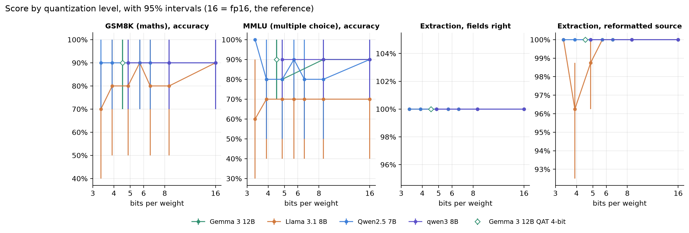
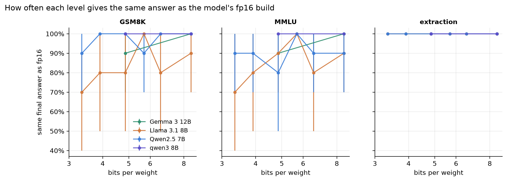

# Results (pilot items)

Generated by `qcliff report` from `results/answers/`. Intervals are 95% item bootstraps (2,000 draws). Drops are paired by item against the same model's fp16 build. Extraction is scored as the share of the 8 fields right per record.

## Score by level

### Llama 3.1 8B (n = 10 per task, 10 records)

Score, and in brackets the drop from fp16 in points.

| level | bits | GSM8K | MMLU | extraction | extraction (reformatted) |
|---|---|---|---|---|---|
| fp16 | 16.0 | 90.0% (+0.0) | 70.0% (+0.0) | 100.0% (+0.0) | 100.0% (+0.0) |
| q8_0 | 8.5 | 80.0% (-10.0) | 70.0% (+0.0) | 100.0% (+0.0) | 100.0% (+0.0) |
| q6_K | 6.56 | 80.0% (-10.0) | 70.0% (+0.0) | 100.0% (+0.0) | 100.0% (+0.0) |
| q5_K_M | 5.69 | 90.0% (+0.0) | 70.0% (+0.0) | 100.0% (+0.0) | 100.0% (+0.0) |
| q4_K_M | 4.85 | 80.0% (-10.0) | 70.0% (+0.0) | 100.0% (+0.0) | 98.8% (-1.2) |
| q3_K_M | 3.91 | 80.0% (-10.0) | 70.0% (+0.0) | 100.0% (+0.0) | 96.2% (-3.8) |
| q2_K | 3.35 | 70.0% (-20.0) | 60.0% (-10.0) | 100.0% (+0.0) | 100.0% (+0.0) |

### Qwen2.5 7B (n = 10 per task, 10 records)

Score, and in brackets the drop from fp16 in points.

| level | bits | GSM8K | MMLU | extraction | extraction (reformatted) |
|---|---|---|---|---|---|
| fp16 | 16.0 | 90.0% (+0.0) | 90.0% (+0.0) | 100.0% (+0.0) | 100.0% (+0.0) |
| q8_0 | 8.5 | 90.0% (+0.0) | 80.0% (-10.0) | 100.0% (+0.0) | 100.0% (+0.0) |
| q6_K | 6.56 | 90.0% (+0.0) | 80.0% (-10.0) | 100.0% (+0.0) | 100.0% (+0.0) |
| q5_K_M | 5.69 | 90.0% (+0.0) | 90.0% (+0.0) | 100.0% (+0.0) | 100.0% (+0.0) |
| q4_K_M | 4.85 | 90.0% (+0.0) | 80.0% (-10.0) | 100.0% (+0.0) | 100.0% (+0.0) |
| q3_K_M | 3.91 | 90.0% (+0.0) | 80.0% (-10.0) | 100.0% (+0.0) | 100.0% (+0.0) |
| q2_K | 3.35 | 90.0% (+0.0) | 100.0% (+10.0) | 100.0% (+0.0) | 100.0% (+0.0) |

### qwen3 8B (n = 10 per task, 10 records)

Score, and in brackets the drop from fp16 in points.

| level | bits | GSM8K | MMLU | extraction | extraction (reformatted) |
|---|---|---|---|---|---|
| fp16 | 16.0 | 90.0% (+0.0) | 90.0% (+0.0) | 100.0% (+0.0) | 100.0% (+0.0) |
| q8_0 | 8.5 | 90.0% (+0.0) | 90.0% (+0.0) | 100.0% (+0.0) | 100.0% (+0.0) |
| q4_K_M | 4.85 | 90.0% (+0.0) | 90.0% (+0.0) | 100.0% (+0.0) | 100.0% (+0.0) |

### Gemma 3 12B (n = 10 per task, 10 records)

Score, and in brackets the drop from fp16 in points.

| level | bits | GSM8K | MMLU | extraction | extraction (reformatted) |
|---|---|---|---|---|---|
| fp16 | 16.0 | 90.0% (+0.0) | 90.0% (+0.0) | 100.0% (+0.0) | 100.0% (+0.0) |
| q8_0 | 8.5 | 90.0% (+0.0) | 90.0% (+0.0) | 100.0% (+0.0) | 100.0% (+0.0) |
| q4_K_M | 4.85 | 90.0% (+0.0) | 80.0% (-10.0) | 100.0% (+0.0) | 100.0% (+0.0) |
| qat | 4.5 | 90.0% (+0.0) | 90.0% (+0.0) | 100.0% (+0.0) | 100.0% (+0.0) |

## Drops from fp16 (pp, paired by item)

| model | task | level | drop | 95% CI | n |
|---|---|---|---|---|---|
| Llama 3.1 8B | GSM8K | q8_0 | -10.0 | [-30.0, +0.0] | 10 |
| Llama 3.1 8B | GSM8K | q6_K | -10.0 | [-30.0, +0.0] | 10 |
| Llama 3.1 8B | GSM8K | q5_K_M | +0.0 | [+0.0, +0.0] | 10 |
| Llama 3.1 8B | GSM8K | q4_K_M | -10.0 | [-30.0, +0.0] | 10 |
| Llama 3.1 8B | GSM8K | q3_K_M | -10.0 | [-30.0, +0.0] | 10 |
| Llama 3.1 8B | GSM8K | q2_K | -20.0 | [-50.0, +0.0] | 10 |
| Llama 3.1 8B | MMLU | q8_0 | +0.0 | [+0.0, +0.0] | 10 |
| Llama 3.1 8B | MMLU | q6_K | +0.0 | [+0.0, +0.0] | 10 |
| Llama 3.1 8B | MMLU | q5_K_M | +0.0 | [+0.0, +0.0] | 10 |
| Llama 3.1 8B | MMLU | q4_K_M | +0.0 | [+0.0, +0.0] | 10 |
| Llama 3.1 8B | MMLU | q3_K_M | +0.0 | [+0.0, +0.0] | 10 |
| Llama 3.1 8B | MMLU | q2_K | -10.0 | [-30.0, +0.0] | 10 |
| Llama 3.1 8B | extraction | q8_0 | +0.0 | [+0.0, +0.0] | 10 |
| Llama 3.1 8B | extraction | q6_K | +0.0 | [+0.0, +0.0] | 10 |
| Llama 3.1 8B | extraction | q5_K_M | +0.0 | [+0.0, +0.0] | 10 |
| Llama 3.1 8B | extraction | q4_K_M | +0.0 | [+0.0, +0.0] | 10 |
| Llama 3.1 8B | extraction | q3_K_M | +0.0 | [+0.0, +0.0] | 10 |
| Llama 3.1 8B | extraction | q2_K | +0.0 | [+0.0, +0.0] | 10 |
| Llama 3.1 8B | extraction (reformatted) | q8_0 | +0.0 | [+0.0, +0.0] | 10 |
| Llama 3.1 8B | extraction (reformatted) | q6_K | +0.0 | [+0.0, +0.0] | 10 |
| Llama 3.1 8B | extraction (reformatted) | q5_K_M | +0.0 | [+0.0, +0.0] | 10 |
| Llama 3.1 8B | extraction (reformatted) | q4_K_M | -1.2 | [-3.8, +0.0] | 10 |
| Llama 3.1 8B | extraction (reformatted) | q3_K_M | -3.8 | [-7.5, -1.2] | 10 |
| Llama 3.1 8B | extraction (reformatted) | q2_K | +0.0 | [+0.0, +0.0] | 10 |
| Qwen2.5 7B | GSM8K | q8_0 | +0.0 | [+0.0, +0.0] | 10 |
| Qwen2.5 7B | GSM8K | q6_K | +0.0 | [+0.0, +0.0] | 10 |
| Qwen2.5 7B | GSM8K | q5_K_M | +0.0 | [+0.0, +0.0] | 10 |
| Qwen2.5 7B | GSM8K | q4_K_M | +0.0 | [+0.0, +0.0] | 10 |
| Qwen2.5 7B | GSM8K | q3_K_M | +0.0 | [+0.0, +0.0] | 10 |
| Qwen2.5 7B | GSM8K | q2_K | +0.0 | [+0.0, +0.0] | 10 |
| Qwen2.5 7B | MMLU | q8_0 | -10.0 | [-30.0, +0.0] | 10 |
| Qwen2.5 7B | MMLU | q6_K | -10.0 | [-30.0, +0.0] | 10 |
| Qwen2.5 7B | MMLU | q5_K_M | +0.0 | [+0.0, +0.0] | 10 |
| Qwen2.5 7B | MMLU | q4_K_M | -10.0 | [-30.0, +0.0] | 10 |
| Qwen2.5 7B | MMLU | q3_K_M | -10.0 | [-30.0, +0.0] | 10 |
| Qwen2.5 7B | MMLU | q2_K | +10.0 | [+0.0, +30.0] | 10 |
| Qwen2.5 7B | extraction | q8_0 | +0.0 | [+0.0, +0.0] | 10 |
| Qwen2.5 7B | extraction | q6_K | +0.0 | [+0.0, +0.0] | 10 |
| Qwen2.5 7B | extraction | q5_K_M | +0.0 | [+0.0, +0.0] | 10 |
| Qwen2.5 7B | extraction | q4_K_M | +0.0 | [+0.0, +0.0] | 10 |
| Qwen2.5 7B | extraction | q3_K_M | +0.0 | [+0.0, +0.0] | 10 |
| Qwen2.5 7B | extraction | q2_K | +0.0 | [+0.0, +0.0] | 10 |
| Qwen2.5 7B | extraction (reformatted) | q8_0 | +0.0 | [+0.0, +0.0] | 10 |
| Qwen2.5 7B | extraction (reformatted) | q6_K | +0.0 | [+0.0, +0.0] | 10 |
| Qwen2.5 7B | extraction (reformatted) | q5_K_M | +0.0 | [+0.0, +0.0] | 10 |
| Qwen2.5 7B | extraction (reformatted) | q4_K_M | +0.0 | [+0.0, +0.0] | 10 |
| Qwen2.5 7B | extraction (reformatted) | q3_K_M | +0.0 | [+0.0, +0.0] | 10 |
| Qwen2.5 7B | extraction (reformatted) | q2_K | +0.0 | [+0.0, +0.0] | 10 |
| qwen3 8B | GSM8K | q8_0 | +0.0 | [+0.0, +0.0] | 10 |
| qwen3 8B | GSM8K | q4_K_M | +0.0 | [+0.0, +0.0] | 10 |
| qwen3 8B | MMLU | q8_0 | +0.0 | [+0.0, +0.0] | 10 |
| qwen3 8B | MMLU | q4_K_M | +0.0 | [+0.0, +0.0] | 10 |
| qwen3 8B | extraction | q8_0 | +0.0 | [+0.0, +0.0] | 10 |
| qwen3 8B | extraction | q4_K_M | +0.0 | [+0.0, +0.0] | 10 |
| qwen3 8B | extraction (reformatted) | q8_0 | +0.0 | [+0.0, +0.0] | 10 |
| qwen3 8B | extraction (reformatted) | q4_K_M | +0.0 | [+0.0, +0.0] | 10 |
| Gemma 3 12B | GSM8K | q8_0 | +0.0 | [+0.0, +0.0] | 10 |
| Gemma 3 12B | GSM8K | q4_K_M | +0.0 | [+0.0, +0.0] | 10 |
| Gemma 3 12B | GSM8K | qat | +0.0 | [+0.0, +0.0] | 10 |
| Gemma 3 12B | MMLU | q8_0 | +0.0 | [+0.0, +0.0] | 10 |
| Gemma 3 12B | MMLU | q4_K_M | -10.0 | [-30.0, +0.0] | 10 |
| Gemma 3 12B | MMLU | qat | +0.0 | [+0.0, +0.0] | 10 |
| Gemma 3 12B | extraction | q8_0 | +0.0 | [+0.0, +0.0] | 10 |
| Gemma 3 12B | extraction | q4_K_M | +0.0 | [+0.0, +0.0] | 10 |
| Gemma 3 12B | extraction | qat | +0.0 | [+0.0, +0.0] | 10 |
| Gemma 3 12B | extraction (reformatted) | q8_0 | +0.0 | [+0.0, +0.0] | 10 |
| Gemma 3 12B | extraction (reformatted) | q4_K_M | +0.0 | [+0.0, +0.0] | 10 |
| Gemma 3 12B | extraction (reformatted) | qat | +0.0 | [+0.0, +0.0] | 10 |

## First clear drop

Walking down from fp16, the first level whose drop is at least 5 points with an interval that excludes zero (QAT left out).

| family | task | variant | first clear drop | drop there | lowest level tested | drop at lowest |
|---|---|---|---|---|---|---|
| gemma3-12b | drift | base | none | – | q4_K_M | +0.0 |
| gemma3-12b | drift | reformatted | none | – | q4_K_M | +0.0 |
| gemma3-12b | gsm8k | base | none | – | q4_K_M | +0.0 |
| gemma3-12b | mmlu | base | none | – | q4_K_M | -10.0 |
| llama3.1-8b | drift | base | none | – | q2_K | +0.0 |
| llama3.1-8b | drift | reformatted | none | – | q2_K | +0.0 |
| llama3.1-8b | gsm8k | base | none | – | q2_K | -20.0 |
| llama3.1-8b | mmlu | base | none | – | q2_K | -10.0 |
| qwen2.5-7b | drift | base | none | – | q2_K | +0.0 |
| qwen2.5-7b | drift | reformatted | none | – | q2_K | +0.0 |
| qwen2.5-7b | gsm8k | base | none | – | q2_K | +0.0 |
| qwen2.5-7b | mmlu | base | none | – | q2_K | +10.0 |
| qwen3-8b | drift | base | none | – | q4_K_M | +0.0 |
| qwen3-8b | drift | reformatted | none | – | q4_K_M | +0.0 |
| qwen3-8b | gsm8k | base | none | – | q4_K_M | +0.0 |
| qwen3-8b | mmlu | base | none | – | q4_K_M | +0.0 |

## Same answer as fp16

| model | task | level | same answer | 95% CI | n |
|---|---|---|---|---|---|
| Llama 3.1 8B | GSM8K | fp16 | 100.0% | [100.0, 100.0] | 10 |
| Llama 3.1 8B | GSM8K | q8_0 | 90.0% | [70.0, 100.0] | 10 |
| Llama 3.1 8B | GSM8K | q6_K | 80.0% | [50.0, 100.0] | 10 |
| Llama 3.1 8B | GSM8K | q5_K_M | 100.0% | [100.0, 100.0] | 10 |
| Llama 3.1 8B | GSM8K | q4_K_M | 80.0% | [50.0, 100.0] | 10 |
| Llama 3.1 8B | GSM8K | q3_K_M | 80.0% | [50.0, 100.0] | 10 |
| Llama 3.1 8B | GSM8K | q2_K | 70.0% | [40.0, 90.0] | 10 |
| Llama 3.1 8B | MMLU | fp16 | 100.0% | [100.0, 100.0] | 10 |
| Llama 3.1 8B | MMLU | q8_0 | 90.0% | [70.0, 100.0] | 10 |
| Llama 3.1 8B | MMLU | q6_K | 80.0% | [50.0, 100.0] | 10 |
| Llama 3.1 8B | MMLU | q5_K_M | 100.0% | [100.0, 100.0] | 10 |
| Llama 3.1 8B | MMLU | q4_K_M | 90.0% | [70.0, 100.0] | 10 |
| Llama 3.1 8B | MMLU | q3_K_M | 80.0% | [50.0, 100.0] | 10 |
| Llama 3.1 8B | MMLU | q2_K | 70.0% | [40.0, 100.0] | 10 |
| Llama 3.1 8B | extraction | fp16 | 100.0% | [100.0, 100.0] | 10 |
| Llama 3.1 8B | extraction | q8_0 | 100.0% | [100.0, 100.0] | 10 |
| Llama 3.1 8B | extraction | q6_K | 100.0% | [100.0, 100.0] | 10 |
| Llama 3.1 8B | extraction | q5_K_M | 100.0% | [100.0, 100.0] | 10 |
| Llama 3.1 8B | extraction | q4_K_M | 100.0% | [100.0, 100.0] | 10 |
| Llama 3.1 8B | extraction | q3_K_M | 100.0% | [100.0, 100.0] | 10 |
| Llama 3.1 8B | extraction | q2_K | 100.0% | [100.0, 100.0] | 10 |
| Qwen2.5 7B | GSM8K | fp16 | 100.0% | [100.0, 100.0] | 10 |
| Qwen2.5 7B | GSM8K | q8_0 | 100.0% | [100.0, 100.0] | 10 |
| Qwen2.5 7B | GSM8K | q6_K | 100.0% | [100.0, 100.0] | 10 |
| Qwen2.5 7B | GSM8K | q5_K_M | 90.0% | [70.0, 100.0] | 10 |
| Qwen2.5 7B | GSM8K | q4_K_M | 100.0% | [100.0, 100.0] | 10 |
| Qwen2.5 7B | GSM8K | q3_K_M | 100.0% | [100.0, 100.0] | 10 |
| Qwen2.5 7B | GSM8K | q2_K | 90.0% | [70.0, 100.0] | 10 |
| Qwen2.5 7B | MMLU | fp16 | 100.0% | [100.0, 100.0] | 10 |
| Qwen2.5 7B | MMLU | q8_0 | 90.0% | [70.0, 100.0] | 10 |
| Qwen2.5 7B | MMLU | q6_K | 90.0% | [70.0, 100.0] | 10 |
| Qwen2.5 7B | MMLU | q5_K_M | 100.0% | [100.0, 100.0] | 10 |
| Qwen2.5 7B | MMLU | q4_K_M | 80.0% | [50.0, 100.0] | 10 |
| Qwen2.5 7B | MMLU | q3_K_M | 90.0% | [70.0, 100.0] | 10 |
| Qwen2.5 7B | MMLU | q2_K | 90.0% | [70.0, 100.0] | 10 |
| Qwen2.5 7B | extraction | fp16 | 100.0% | [100.0, 100.0] | 10 |
| Qwen2.5 7B | extraction | q8_0 | 100.0% | [100.0, 100.0] | 10 |
| Qwen2.5 7B | extraction | q6_K | 100.0% | [100.0, 100.0] | 10 |
| Qwen2.5 7B | extraction | q5_K_M | 100.0% | [100.0, 100.0] | 10 |
| Qwen2.5 7B | extraction | q4_K_M | 100.0% | [100.0, 100.0] | 10 |
| Qwen2.5 7B | extraction | q3_K_M | 100.0% | [100.0, 100.0] | 10 |
| Qwen2.5 7B | extraction | q2_K | 100.0% | [100.0, 100.0] | 10 |
| qwen3 8B | GSM8K | fp16 | 100.0% | [100.0, 100.0] | 10 |
| qwen3 8B | GSM8K | q8_0 | 100.0% | [100.0, 100.0] | 10 |
| qwen3 8B | GSM8K | q4_K_M | 100.0% | [100.0, 100.0] | 10 |
| qwen3 8B | MMLU | fp16 | 100.0% | [100.0, 100.0] | 10 |
| qwen3 8B | MMLU | q8_0 | 100.0% | [100.0, 100.0] | 10 |
| qwen3 8B | MMLU | q4_K_M | 100.0% | [100.0, 100.0] | 10 |
| qwen3 8B | extraction | fp16 | 100.0% | [100.0, 100.0] | 10 |
| qwen3 8B | extraction | q8_0 | 100.0% | [100.0, 100.0] | 10 |
| qwen3 8B | extraction | q4_K_M | 100.0% | [100.0, 100.0] | 10 |
| Gemma 3 12B | GSM8K | fp16 | 100.0% | [100.0, 100.0] | 10 |
| Gemma 3 12B | GSM8K | q8_0 | 100.0% | [100.0, 100.0] | 10 |
| Gemma 3 12B | GSM8K | q4_K_M | 90.0% | [70.0, 100.0] | 10 |
| Gemma 3 12B | GSM8K | qat | 100.0% | [100.0, 100.0] | 10 |
| Gemma 3 12B | MMLU | fp16 | 100.0% | [100.0, 100.0] | 10 |
| Gemma 3 12B | MMLU | q8_0 | 100.0% | [100.0, 100.0] | 10 |
| Gemma 3 12B | MMLU | q4_K_M | 90.0% | [70.0, 100.0] | 10 |
| Gemma 3 12B | MMLU | qat | 100.0% | [100.0, 100.0] | 10 |
| Gemma 3 12B | extraction | fp16 | 100.0% | [100.0, 100.0] | 10 |
| Gemma 3 12B | extraction | q8_0 | 100.0% | [100.0, 100.0] | 10 |
| Gemma 3 12B | extraction | q4_K_M | 100.0% | [100.0, 100.0] | 10 |
| Gemma 3 12B | extraction | qat | 100.0% | [100.0, 100.0] | 10 |

## Noise floor (A/A: the same prompt sent twice)

| family | level | task | n | changed |
|---|---|---|---|---|
| llama3.1-8b | fp16 | gsm8k | 10 | 0 |
| llama3.1-8b | fp16 | mmlu | 10 | 0 |
| llama3.1-8b | q4_K_M | gsm8k | 10 | 1 |
| llama3.1-8b | q4_K_M | mmlu | 10 | 0 |
| qwen2.5-7b | fp16 | gsm8k | 10 | 0 |
| qwen2.5-7b | fp16 | mmlu | 10 | 0 |
| qwen2.5-7b | q4_K_M | gsm8k | 10 | 0 |
| qwen2.5-7b | q4_K_M | mmlu | 10 | 0 |
| qwen3-8b | fp16 | gsm8k | 10 | 0 |
| qwen3-8b | fp16 | mmlu | 10 | 0 |
| qwen3-8b | q4_K_M | gsm8k | 10 | 0 |
| qwen3-8b | q4_K_M | mmlu | 10 | 0 |
| gemma3-12b | fp16 | gsm8k | 10 | 0 |
| gemma3-12b | fp16 | mmlu | 10 | 0 |
| gemma3-12b | q4_K_M | gsm8k | 10 | 1 |
| gemma3-12b | q4_K_M | mmlu | 10 | 0 |

## Validity

| family | level | bits | unparsed (maths+MC) | truncated | extraction JSON parsed | extraction strict JSON | mean output tokens (GSM8K) |
|---|---|---|---|---|---|---|---|
| gemma3-12b | fp16 | 16.0 | 0 | 0 | 20/20 | 0/20 | 174.0 |
| gemma3-12b | q8_0 | 8.5 | 0 | 0 | 20/20 | 0/20 | 168.0 |
| gemma3-12b | q4_K_M | 4.85 | 0 | 1 | 20/20 | 0/20 | 252.0 |
| gemma3-12b | qat | 4.5 | 0 | 0 | 20/20 | 0/20 | 162.0 |
| llama3.1-8b | fp16 | 16.0 | 0 | 0 | 20/20 | 0/20 | 202.0 |
| llama3.1-8b | q8_0 | 8.5 | 0 | 0 | 20/20 | 0/20 | 217.0 |
| llama3.1-8b | q6_K | 6.56 | 0 | 0 | 20/20 | 0/20 | 203.0 |
| llama3.1-8b | q5_K_M | 5.69 | 0 | 0 | 20/20 | 0/20 | 194.0 |
| llama3.1-8b | q4_K_M | 4.85 | 0 | 1 | 20/20 | 0/20 | 296.0 |
| llama3.1-8b | q3_K_M | 3.91 | 0 | 0 | 20/20 | 0/20 | 279.0 |
| llama3.1-8b | q2_K | 3.35 | 1 | 1 | 20/20 | 20/20 | 299.0 |
| qwen2.5-7b | fp16 | 16.0 | 0 | 0 | 20/20 | 20/20 | 266.0 |
| qwen2.5-7b | q8_0 | 8.5 | 0 | 0 | 20/20 | 20/20 | 268.0 |
| qwen2.5-7b | q6_K | 6.56 | 0 | 0 | 20/20 | 20/20 | 270.0 |
| qwen2.5-7b | q5_K_M | 5.69 | 0 | 0 | 20/20 | 20/20 | 277.0 |
| qwen2.5-7b | q4_K_M | 4.85 | 0 | 0 | 20/20 | 20/20 | 256.0 |
| qwen2.5-7b | q3_K_M | 3.91 | 0 | 0 | 20/20 | 20/20 | 260.0 |
| qwen2.5-7b | q2_K | 3.35 | 0 | 0 | 20/20 | 20/20 | 245.0 |
| qwen3-8b | fp16 | 16.0 | 0 | 0 | 20/20 | 20/20 | 259.0 |
| qwen3-8b | q8_0 | 8.5 | 0 | 0 | 20/20 | 20/20 | 280.0 |
| qwen3-8b | q4_K_M | 4.85 | 0 | 0 | 20/20 | 20/20 | 284.0 |

## Speed and size

Median generation speed on GSM8K replies on this laptop (a rough guide).

| family | level | tokens/s | size_gb |
|---|---|---|---|
| gemma3-12b | fp16 | 12.2 | 24.4 |
| gemma3-12b | q4_K_M | 32.9 | 8.16 |
| gemma3-12b | q8_0 | 21.5 | 13.37 |
| gemma3-12b | qat | 32.0 | 8.93 |
| llama3.1-8b | fp16 | 8.5 | 16.07 |
| llama3.1-8b | q2_K | 20.8 | 3.18 |
| llama3.1-8b | q3_K_M | 23.4 | 4.02 |
| llama3.1-8b | q4_K_M | 24.8 | 4.92 |
| llama3.1-8b | q5_K_M | 15.6 | 5.73 |
| llama3.1-8b | q6_K | 17.0 | 6.6 |
| llama3.1-8b | q8_0 | 17.7 | 8.54 |
| qwen2.5-7b | fp16 | 10.2 | 15.24 |
| qwen2.5-7b | q2_K | 26.8 | 3.02 |
| qwen2.5-7b | q3_K_M | 21.5 | 3.81 |
| qwen2.5-7b | q4_K_M | 18.7 | 4.68 |
| qwen2.5-7b | q5_K_M | 15.7 | 5.44 |
| qwen2.5-7b | q6_K | 16.0 | 6.25 |
| qwen2.5-7b | q8_0 | 14.4 | 8.1 |
| qwen3-8b | fp16 | 9.9 | 16.39 |
| qwen3-8b | q4_K_M | 46.6 | 5.23 |
| qwen3-8b | q8_0 | 33.2 | 8.85 |
